# Donanım (mekanik parçalar ve montaj)

> **Kaynak:** Bu klasör [ggldnl/H-0996-Hardware](https://github.com/ggldnl/H-0996-Hardware) deposunun `5d695c1` commit'inden alınmıştır. Tasarımın yazarı ggldnl'dir; lisansı **CERN-OHL-W-2.0**'dır (bkz. [LICENSE.md](LICENSE.md)). Bu lisans; kaynak gösterilmesini, değiştirilen dosyaların aynı lisansla paylaşılmasını ve değişikliklerin belirtilmesini gerektirir.
> **Yaptığımız değişiklikler:** CAD, STL, STEP, URDF ve medya dosyaları değiştirilmeden kopyalandı. Bu README Türkçeye çevrildi; robotumuza özel notlar "Bizim kurulumumuz" kutularında belirtildi. Projeye göre değiştirdiğimiz parçalar `CAD/modified/` altında tutulur.

    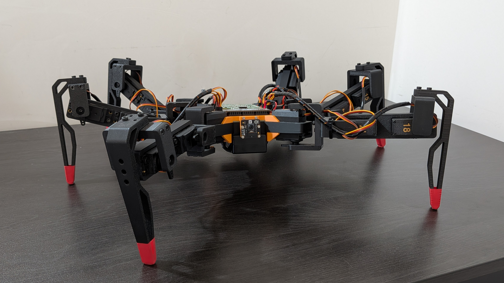

Bu klasör hexapod robotunu üretmek için gereken 3B baskı parçaları, malzeme listesini ve montaj rehberini içerir.

Firmware için [firmware/](../firmware/README.md), Raspberry Pi tarafı için [controller/](../controller/README.md) klasörüne bakın.

## 🖼️ Render

Fusion 360 render'ına [buradan](https://a360.co/3SQCzxe) ulaşılabilir.

[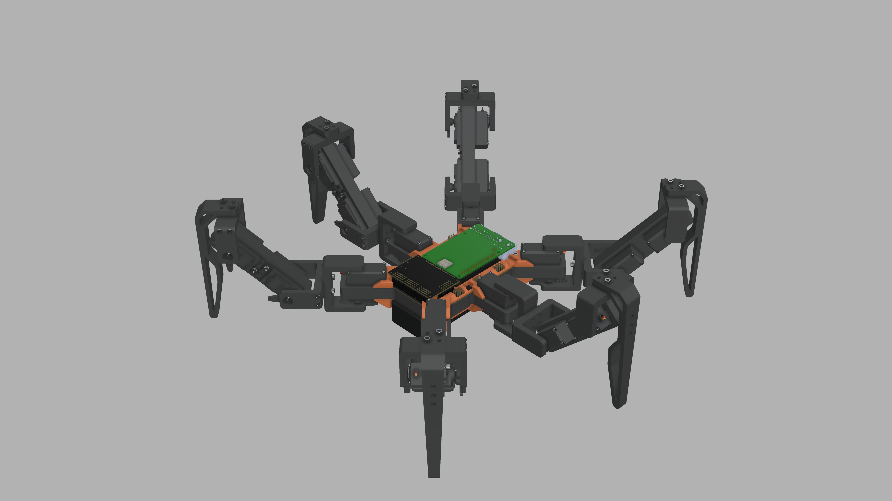](https://a360.co/3SQCzxe)

## 📋 Malzeme listesi

Hexapod'u yapmak için gereken bileşenlerin özeti:

| Kategori | Bileşen | Adet | Notlar | Parça başı maliyet |
|----------|-----------|----------|-------|---------------|
| Mekanik bileşenler | 3B baskı parçalar | | 6 × `tibia`, 6 × `femur`, ... (bkz. [montaj talimatları](#-montaj-talimatları)) | |
| | M3 vida | 92 |  | Yazar Amazon'dan yaklaşık 12 €'ya 800 parçalık karışık bir set almış ve setteki farklı boyları kullanmış. Deliklere uyduğu sürece boy önemli değil |
| | F686ZZ rulman | 18 | Her motorun arkası için bir tane | Amazon'da 20 adet yaklaşık 10 € |
| | M3 heat-set insert | 92 |  | Yazar Amazon'dan yaklaşık 10 €'ya 150 parçalık bir set almış |
| Elektronik | MG996/MG996R servo | 18 | MG996R daha ucuz ama MG996'dan daha zayıftır; yine de iş görür | Aliexpress'te yaklaşık 70 € |
| | Servo2040 | 1 | Yerine eşdeğer bir kart kullanılabilir, ör. 2 × Pololu Mini Maestro | Pimoroni sitesinde yaklaşık 28 € |
| | Raspberry Pi 5 | 1 | Başka sürümler de kullanılabilir | Amazon'da yaklaşık 100 € |
| | 7,4 V 2S LiPo batarya | 1 | Genellikle çift satılırlar; yazar 50 €'ya iki tane almış | Amazon'da yaklaşık 25 € |
| | 8 A UBEC | 2 | İki tane gerekir: biri servolar, biri elektronik için. Yazar [bunları](https://it.aliexpress.com/item/1005007467083035.html) kullanmış: iki kanallı, giriş voltajı seçilebilir ve açma/kapama düğmeli. `battery_mount` parçasında bu tip UBEC'leri tutan iki yuva vardır. Farklı bir model kullanırsanız parçayı yeniden tasarlamanız gerekir | Aliexpress'te tanesi yaklaşık 20 € |

Yaklaşık toplam maliyet: 280 € civarı.

Malzeme listesindeki fiyatlar satın alma tarihindeki maliyetleri yansıtır ve artık geçerli olmayabilir. Liste yalnızca referans içindir, kesin maliyet tahmini olarak kullanılmamalıdır.

Yukarıdaki tüm bileşenler zorunludur. Yazarın tasarladığı [özel PCB'nin](https://github.com/ggldnl/H-0996-PCB) kullanılıp kullanılmamasına göre iki montaj yolu vardır.

1. Özel PCB ile

    Özel PCB maliyeti biraz artırır (yaklaşık 60-70 € fazla) ama montajı kolaylaştırır, gövdeyi ince tutar, sağlam bir taban plakası görevi görür ve elle kablolama yapmaktan kurtarır. Daha fazla bilgi için [H-0996 PCB deposuna](https://github.com/ggldnl/H-0996-PCB) bakın.

    PCB tamamen isteğe bağlıdır; birkaç kuruş tasarruf etmek isterseniz atlayabilirsiniz, ama yazar şiddetle tavsiye ediyor.

2. Özel PCB olmadan

    PCB kullanılmazsa elektronik yine monte edilebilir, ama bazı ödünler ve ek parçalarla. Şunlar gerekir:

    - Servo2040 ve Raspberry Pi'yi monte etmek için adaptör plakası `electronics_mount.stl`'yi basın. Sonuç daha hantal olur ve kablolar her yere dağılır;
    - arka bacaklar Servo2040'a çok uzak olduğu için servo uzatma kabloları alın;
    - M2 heat-set insert ve M2 vida alın (Servo2040'ın montaj delikleri 2,7 mm).

    Gerekenler hazır olunca M2 heat-set insert'leri `electronics_mount.stl`'deki küçük deliklere takın, iki kartı sabitleyin ve [firmware rehberine](../firmware/README.md#-bağlantı) göre bağlayın.

> **Bizim kurulumumuz:** PCB'siz yolu kullanıyoruz. UBEC olarak Hobbywing UBEC 10A V2-Car (servolar, 6,0 V) ve Hobbywing UBEC 5A V2-Air (Pi, 5,0 V) kullanıyoruz; bu modeller `battery_mount` yuvalarına tam oturmadığı için parçayı uyarlıyoruz (`CAD/modified/`). Batarya ile UBEC'ler arasına ayrıca 25 A sigorta ekliyoruz. Ayrıntılar: [docs/hardware.md](../docs/hardware.md), [docs/wiring.md](../docs/wiring.md).

## 🖨️ 3B baskı profili

Robot parçalarının baskı profilleri ve STL dosyaları [MakerWorld'de](https://makerworld.com/models/2655972-hexapod) de yayımlanmıştır. STL dosyaları bu klasörde `CAD/stl/parts/` altındadır.

Parçaların sağlam olması ve doğru oturması için önerilen baskı ayarlarına uyun.

> **Bizim kurulumumuz:** Baskıdaki insert delikleri Ø4,5 mm çıktığı için dış çapı 5 mm, boyu 4 mm (OD5 L4) M3 insert kullanıyoruz.

## 🔨 Montaj talimatları

Aşağıdaki her adımda kısa bir video vardır.

1. Servolarda küçük bir değişiklik gerekir: plastik gövdenin alt kısmını, F686ZZ rulmanı tutacak şekilde tasarlanmış 3B baskı parça `servo_mod.stl` ile değiştirin. Bu değişiklik tamamen geri alınabilir. Yazar, rulman ile devre kartı arasına önlem olarak küçük bir parça kapton bant da koymuş. Baskı parçayı aynı vidalarla sabitleyebilirsiniz.

    <table>
        <tr>
            <td>
                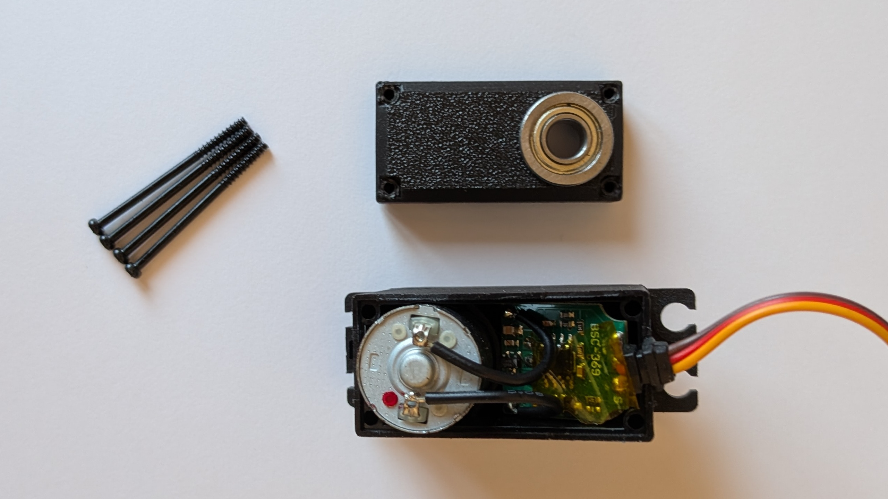
            </td>
            <td>
                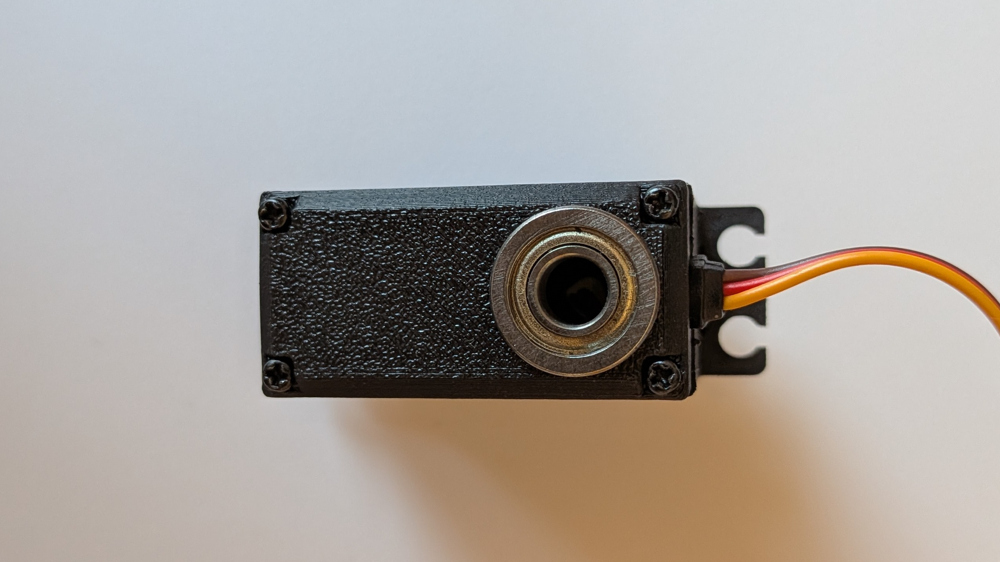
            </td>
        </tr>
    </table>

2. Heat-set insert'leri 3B baskı parçalara takın. Bazı yerlerde (servo göbekleri ve braketler) heat-set insert için 4 delik modellenmiş ama yazar yalnızca 2'sini kullanmış ve sorun yaşamamış.

    <a href="media/videos/heat_set_inserts.mp4">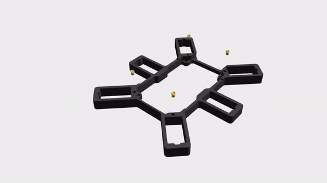</a>

3. Şimdi bacaklar. Bunlardan 6 tane yapmanız gerekecek.

    <a href="media/videos/leg_assembly.mp4">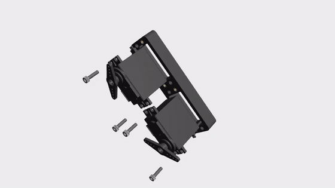</a>

4. Tüm bacakları gövdeye bağlayın.

    <a href="media/videos/legs_to_base.mp4">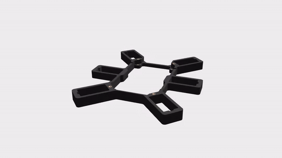</a>

5. Elektroniği ekleyin. Üst ve alt güçlendirme parçaları (`top_stiffeners`, `bottom_stiffeners`) isteğe bağlı DEĞİLDİR: gövdenin esnemesini önlerler. Servolara gerçekten temas ettiklerinden emin olun. Daha yüksek doluluk oranı (infill) da yardımcı olabilir.

    <a href="media/videos/electronics_to_base.mp4">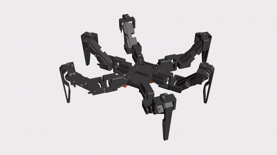</a>

    <table>
        <tr>
            <td>
                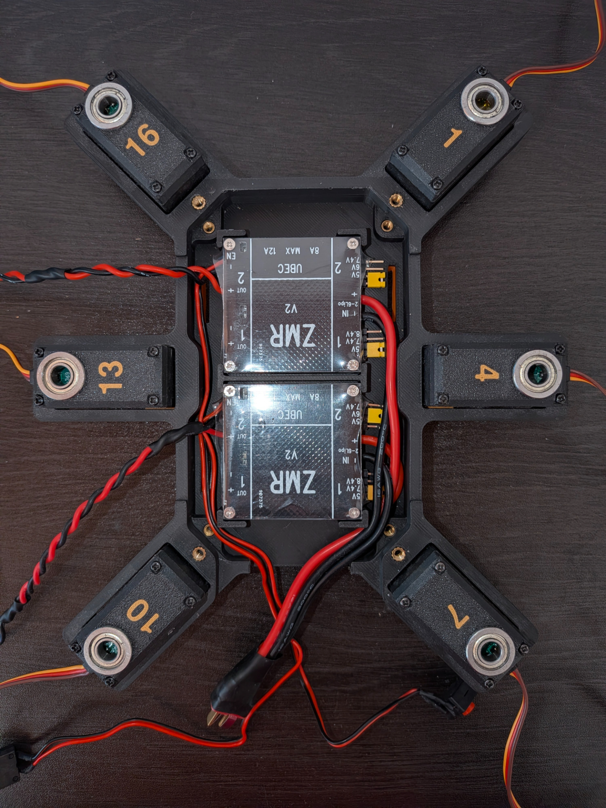
            </td>
            <td>
                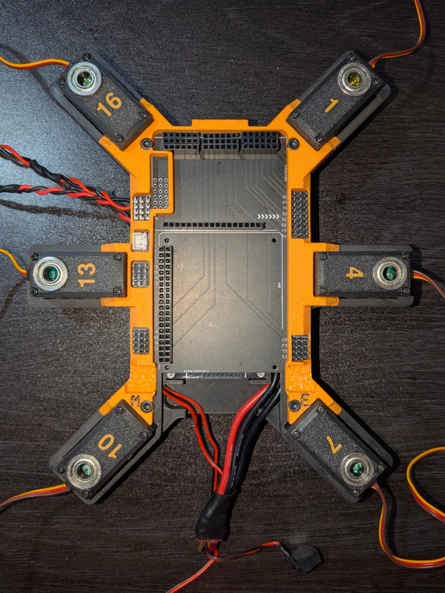
            </td>
            <td>
                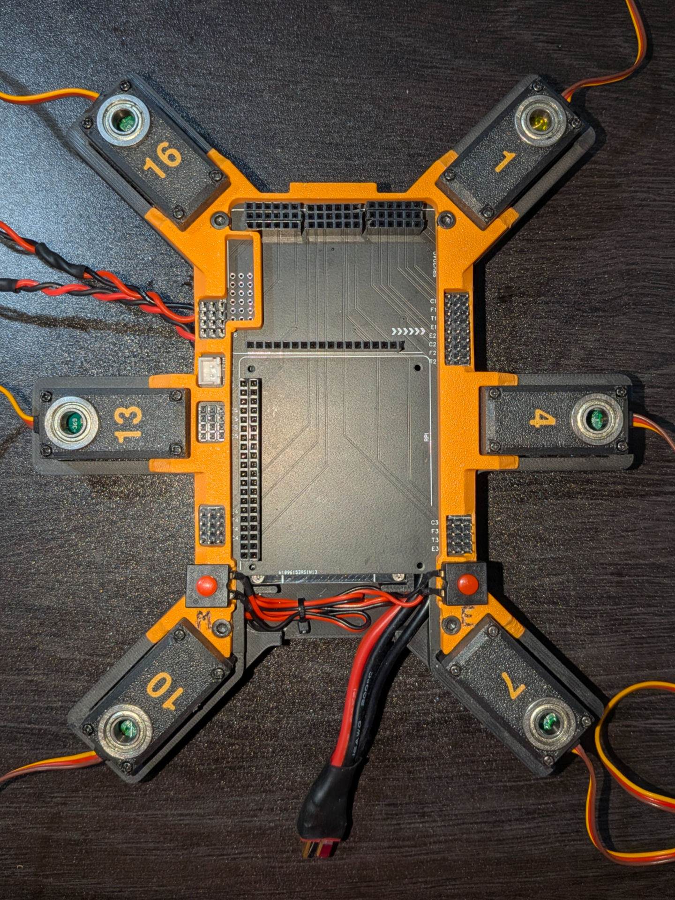
            </td>
        </tr>
    </table>

   - İsterseniz yer açmak için iki UBEC'in kullanılmayan kanalının kablolarını kesin. Gerekirse ileride bir projede tekrar lehimleyebilirsiniz.
   - UBEC'lerden birini Raspberry Pi/Servo2040'ı beslemek için kullanın. Özel PCB kullanıyorsanız bunun için bir konnektörü vardır. Kullandığınız kanalda UBEC'in 5 V verdiğinden emin olun, yoksa kartları yakarsınız. Özel PCB kullanmıyorsanız Pi'nin açıktaki pinlerini kullanabilirsiniz; Servo2040 gücünü UART bağlantısından alır.
   - Diğer UBEC'i, Servo2040 üzerindeki klemens üzerinden servoları beslemek için kullanın. Servolar 6 V ile beslenebilir (emin olmak için veri sayfalarına bakın). Yine, kullandığınız kanalda doğru voltajı seçtiğinizden emin olun.
   - İki UBEC'in girişlerini birlikte lehimleyin.

    > **Bizim kurulumumuz:** Servo2040'ın "Separate USB and Ext. Power" izini kesiyoruz (6 V servo hattı ile Pi'den gelen 5 V ayrı kalsın diye). Bağlantı tablosu ve ilk açılış sırası: [docs/wiring.md](../docs/wiring.md).

6. Robota güç verin.

## 📝 Notlar

1. Tüm bacaklar aynı temel parçaları kullanır (`CAD/stl/parts`): `femur.stl`, `tibia.stl`, 3 × `bracket_A.stl` ve 3 × `bracket_B.stl`.
2. Her servo için bir tane olmak üzere `servo_mod.stl` gerekir (upstream metninde 12 yazıyor; 18 servo için 18 adet basılmalıdır). Değişiklik tamamen geri alınabilir.
3. `CAD/stl/hardware` klasöründeki dosyalar (`MG996R.stl`, `battery.stl`, `electronics.stl`, ...) simülasyon için URDF'te kullanılır; basmanız gerekmez. Bkz. [montaj talimatları](#-montaj-talimatları).
4. Özel PCB'yi kullanmak istemiyorsanız `CAD/stl/parts/electronics_mount.stl` parçasını basmanız ve birkaç bileşen daha almanız gerekir (M2 heat-set insert ve vida). Bkz. [bu bölüm](#-malzeme-listesi).
5. Basılan parçaları dilediğiniz gibi düzenleyebilirsiniz. STEP dosyaları `CAD/step/parts` klasöründedir.

## 🤝 Kaynak

Tasarımın yazarı ggldnl'dir. Proje hakkında daha fazla bilgi için [ana H-0996 deposuna](https://github.com/ggldnl/H-0996) bakın.
